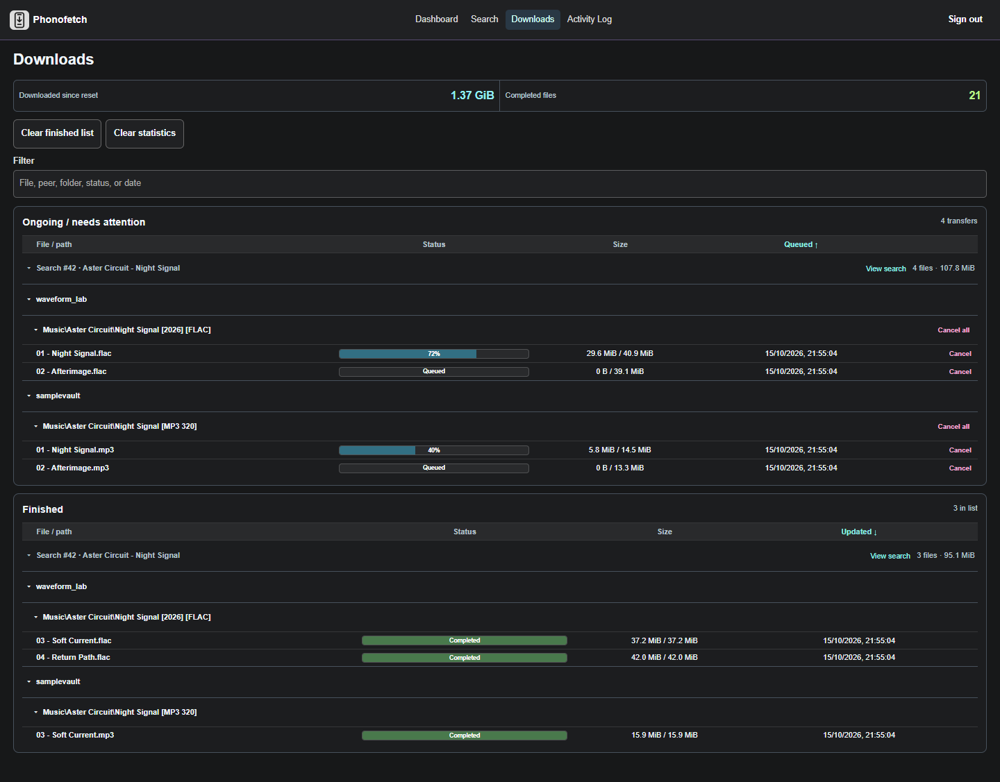
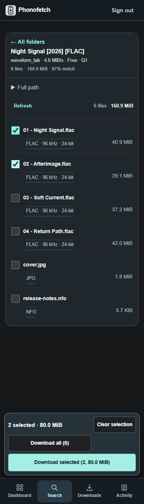
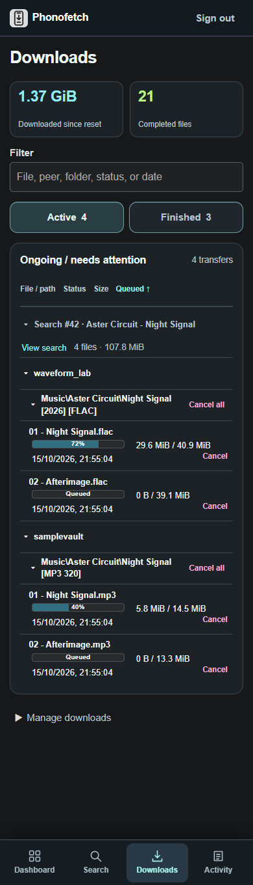

# Phonofetch


Phonofetch is a self-hosted Soulseek search and download interface for an **existing slskd** instance. Search across peers, inspect folders, choose files and follow transfers from a desktop or phone. slskd and your downloads stay on your server.

Search directly from the Dashboard, or use the Search tab for multiple queries and optional automatic downloads. Manual searches can queue files from several folders; already queued files cannot be selected again. In an inspected folder, **Download all** includes selectable audio and non-audio files; **Download selected** queues only the checked files.
If all inspected files have already been queued, the file list starts collapsed; expand **Files** to review it.
Folder inspections expire after ten minutes. Reopening an older search shows its search hits once, not the stale folder listing; use **Refresh** to inspect the full folder again without rerunning the search.

The Dashboard, Downloads and Activity Log have filterable tables with clickable sort headers; track-result tables sort the same way. On phones, tables use compact list rows and plain-text sort headings. Recent downloads group files by search; the Downloads table uses the compact search-results style and nests each search's files under collapsible peer and folder headings, so the path appears once per folder. Select a search, peer, or folder heading to collapse or expand its rows. Ongoing files start in queue order; finished files start newest first. Active progress bars estimate movement between updates (marked `≈`); transferred bytes and completion still come from slskd.

Use **Cancel all** on a Downloads folder row to cancel its ongoing files from that peer and search, including files not currently loaded in the table. Other folders, peers and completed downloads are left alone; any files that slskd could not cancel are reported explicitly. Individual file cancellation remains available.

Failed downloads display the reason reported by slskd when available. If no detail is reported, inspect that transfer in slskd.

Actions such as downloading selected files, cancelling transfers, and clearing lists use compact confirmation dialogs. Successful requests show brief notices; errors remain visible in the page and Activity Log. Select a result's format/bitrate to open its peer-reported file details and copy the full path. The Activity Log also offers **Copy error**. If clipboard access is unavailable (for example, on an insecure LAN page), the text stays selectable for manual copying.

## Screenshots

Current desktop and phone views with synthetic search and transfer data. Select a thumbnail to view it full size.

### Desktop
<p>
  <a href="./docs/search-results-demo.png"></a>
  <a href="./docs/downloads-demo.png"></a>
</p>

### Mobile
<p>
  <a href="./docs/mobile-search-demo.png"></a>
  <a href="./docs/mobile-downloads-demo.png"></a>
</p>

## Deploy

You need Docker Compose, a running slskd instance (tested with 0.26.1), and a **ReadWrite slskd API key**. The supplied [Compose file](./compose.yaml) expects slskd at `http://slskd:5030` on the external Docker network `phonofetch_net`. It stores data at `/volume2/docker/phonofetch` and opens **port 7289 on your LAN**. Adjust the Compose file first if those names or paths differ. Phonofetch does not install slskd.

If that network does not exist, run `docker network create phonofetch_net`. If slskd is not attached, run `docker network connect phonofetch_net slskd` (replace `slskd` with its container name). Skip both if slskd already uses the network.

On the NAS:

```sh
cd /volume2/docker
git clone https://github.com/AMBIENTCORE/Phonofetch.git Phonofetch
cd Phonofetch
docker network inspect phonofetch_net
mkdir -p /volume2/docker/phonofetch
sudo chown 1000:1000 /volume2/docker/phonofetch
cp .env.example .env
chmod 600 .env
```

Edit `.env`: set `SLSKD_API_KEY` to the **raw** ReadWrite secret (not `role=ReadWrite;`), choose `PHONOFETCH_AUTH_USERNAME` and a strong `PHONOFETCH_AUTH_PASSWORD`, and set `PHONOFETCH_SESSION_SECRET` to at least 32 random characters. Keep `.env` on the NAS and out of Git.

```sh
docker build -t phonofetch:local .
docker compose --env-file .env -f compose.yaml -p phonofetch up -d
```

Open `http://NAS-IP:7289`. **Do not forward port 7289 on your router.**

### Update an existing NAS install

For the CLI-managed installation in `/volume2/docker/Phonofetch`, download and review [the updater](./scripts/update-nas.sh) once, then check it:

```sh
curl -fL https://raw.githubusercontent.com/AMBIENTCORE/Phonofetch/main/scripts/update-nas.sh -o /volume2/docker/Phonofetch/update.sh
sh /volume2/docker/Phonofetch/update.sh --check
```

After future pushes to `main`, run `sh /volume2/docker/Phonofetch/update.sh`. It builds the new image, backs up SQLite and recreates **only Phonofetch**. Re-download the script if the updater itself changes. It requires an existing database and the Compose project above; it is **not** a first-install command.

### Private access from outside your LAN

Put a VPN or Cloudflare Access in front of the app. With Cloudflare, restrict a Self-hosted Access application to your account **before** publishing a Tunnel route to `http://phonofetch:3000`. Use [the separate tunnel Compose file](./scripts/tunnel.compose.yaml), not the Phonofetch project. On the NAS, set `TRUST_PROXY=true` in Phonofetch's `.env`. Get the connector token privately from the tunnel's **Add a replica** page; put `TUNNEL_TOKEN=<token>` in a separate NAS-only `tunnel.env` (mode `600`), never in Git:

```sh
chmod 600 tunnel.env
docker compose --env-file tunnel.env -f scripts/tunnel.compose.yaml -p phonofetch-tunnel up -d
docker compose --env-file .env -f compose.yaml -p phonofetch up -d --no-deps --force-recreate phonofetch
```

The tunnel needs no router port forward. To use a path on a separate homepage, redirect that path to the protected app hostname; future app updates do not require homepage redeployment.

## Good to know

- Manual selection accepts any valid-size file, even non-audio extras; the FLAC/MP3 filters change what you *see*. Strict audio quality rules apply only to optional automatic downloads. Folder selection is bounded by `MAX_FOLDER_FILES` and `MAX_FOLDER_BYTES` in `.env`.
- On iPhone, open the HTTPS app in Safari, sign in, then use **Share → Add to Home Screen**.

[AMBIENTCORE](https://github.com/AMBIENTCORE) · [MIT License](./LICENSE) · [Issues](https://github.com/AMBIENTCORE/Phonofetch/issues)
