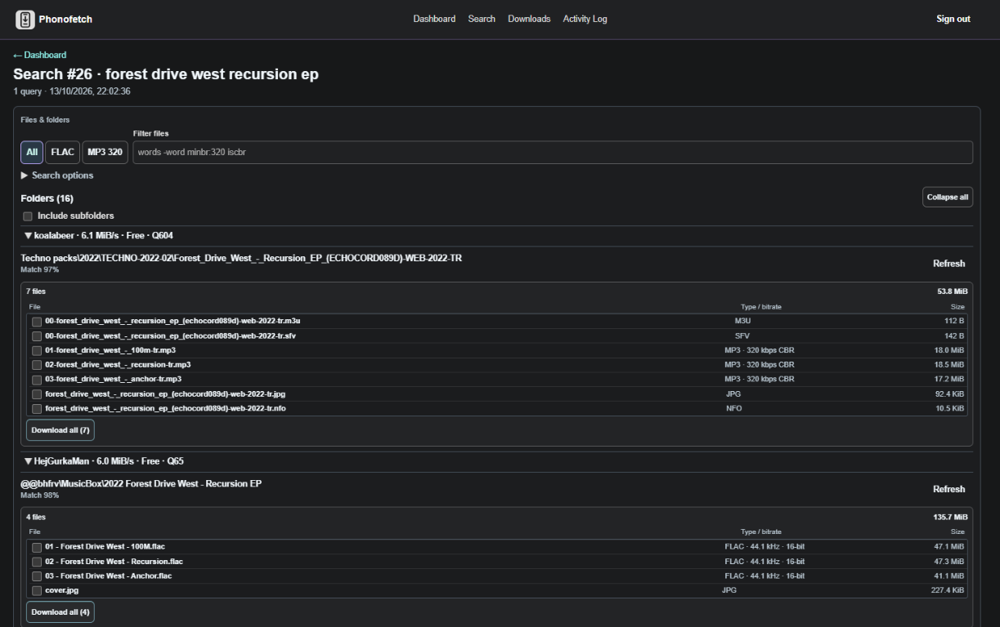

# Phonofetch

Phonofetch is a self-hosted, phone-friendly search and download manager for an **existing slskd instance**. Each line is a full-text Soulseek search; choose a file or inspect a folder from the results, then queue qualifying files through slskd. Transfers and the Activity Log continue on the server after you close the browser.



*Demo screenshot with synthetic peer and file names.*

## Search and download

- Results are grouped by peer and folder. The leading folders are inspected automatically; expand **Other folders** or select **Inspect** to browse more. Search hits can queue one file directly; selecting multiple files requires a verified folder inspection. File and folder sizes are shown before downloading.
- If a peer's folder is too large to inspect, queue a supported audio file directly from its search hits. The `MAX_FOLDER_FILES` preview limit counts supported audio files, not cover art or other extras; raise it in the NAS-only `.env` only if you need larger folder previews.
- File rows show type and peer-reported bitrate (for example, **MP3 · 320 kbps**). **? kbps** means the peer did not supply a reliable value; Phonofetch never infers it from the filename or size.
- Select files with checkboxes and **Download selected**, use **Download all** for the eligible files in a folder, or right-click a file. A track search downloads one selected file.
- Results start on **All**. After searching, filter by **FLAC**, **MP3 320** (peer-reported bitrate), or terms such as `-live`, `minbr:320` and `iscbr`. Add `iscbr` if confirmed constant bitrate is required. Unknown-bitrate files remain visible and selectable under All.
- Searches collect responses for about five seconds, then show quality-checked matches with peer-reported upload speed and free-slot status. Use **Search longer** if a fast search misses later peers; it replaces that query's results.
- The Dashboard shows recent downloads and searches. Each search can contain multiple queries (one per line). **Downloads** groups active and finished transfers by peer and folder, with inline progress and expand/collapse controls. **Clear finished list** hides only finished entries; **Clear statistics** resets the totals separately. Neither deletes files or cancels an active transfer.
- **New Search** asks only for text. Queue one search hit or select files from an inspected folder. Automatic track or whole-album downloading is optional under **Automatic download**, with an explicit quality requirement.

## Install

You need Docker, an existing slskd 0.26.1 container on the external Docker network `phonofetch_net`, and a slskd API key with **ReadWrite** access. The supplied [compose.yaml](./compose.yaml) assumes slskd is reachable as `http://slskd:5030`, uses NAS port `7289`, and stores SQLite in `/volume2/docker/phonofetch`; adjust these paths if your setup differs. It does not modify slskd or Nicotine+.

In a directory containing the repository files, run:

```sh
docker network inspect phonofetch_net
mkdir -p /volume2/docker/phonofetch
# The application runs as UID 1000; grant this user write access to the data folder.
sudo chown 1000:1000 /volume2/docker/phonofetch
cp .env.example .env
# Edit .env: set SLSKD_API_KEY (raw secret, not "role=ReadWrite;"),
# PHONOFETCH_AUTH_USERNAME, PHONOFETCH_AUTH_PASSWORD and
# PHONOFETCH_SESSION_SECRET (at least 32 random characters).
chmod 600 .env
docker build -t phonofetch:local .
docker compose --env-file .env -f compose.yaml up -d
```

Open `http://NAS-IP:7289` on your local network. Keep `.env` **only on the NAS**, never in Git. Do not forward this port publicly; use a VPN or properly secured HTTPS proxy for remote access.

## Update

For the existing **CLI-managed** NAS installation at `/volume2/docker/Phonofetch`, install the [updater](./scripts/update-nas.sh) once after reviewing it:

```sh
curl -fL https://raw.githubusercontent.com/AMBIENTCORE/Phonofetch/main/scripts/update-nas.sh -o /volume2/docker/Phonofetch/update.sh
sh /volume2/docker/Phonofetch/update.sh --check
```

After pushing changes to GitHub, update with `sh /volume2/docker/Phonofetch/update.sh`. It builds the new image, tests non-root access, backs up SQLite, recreates **only** Phonofetch, and checks container health. If the updater itself changes, download and review its new version again. Backups and the database stay on the NAS; live Soulseek behavior depends on your slskd/peer connections.
