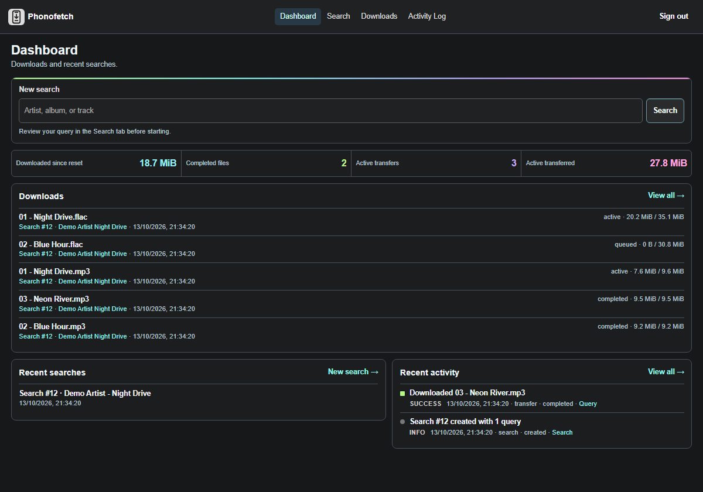
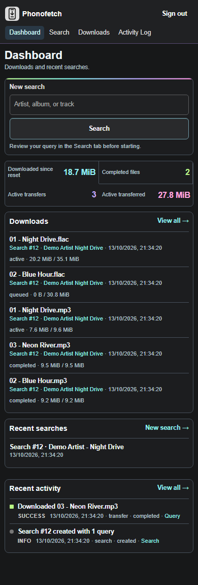

# Phonofetch

**Find it on your phone. Download it on your NAS.**

Phonofetch is a web interface for your **existing slskd** instance. Search Soulseek, look inside a peer's folder, and pick exactly what you want. The transfers keep running on your server after you close the page.


*Screenshots use made-up music, peers and transfers.*

## Why Phonofetch?

- **Browse before you queue.** Search across peers, filter results, and inspect the rest of a folder.
- **Pick the actual files.** Grab one track, a handful of files, or the whole folder, including covers, playlists and NFOs. Automatic track or album downloading is opt-in.
- **Keep tabs on downloads.** See progress, retry failed files and revisit past searches without sitting at your desktop.
- **Keep it yours.** slskd, downloads and Phonofetch's SQLite database stay on your own machine.

## A quick look

The **Dashboard** puts a new search, recent downloads and activity in one place.



**Downloads** groups transfers by peer and folder, with progress and per-file controls.


The same workflow fits a phone: start from the dashboard, then inspect folders and select files in Search.

<p>
  <a href="./docs/mobile-dashboard-demo.png"></a>
  <a href="./docs/mobile-search-demo.png"></a>
</p>

## Deploy

You need Docker Compose, a running slskd instance (tested with 0.26.1), and a **ReadWrite slskd API key**. The supplied [Compose file](./compose.yaml) expects slskd at `http://slskd:5030` on the external Docker network `phonofetch_net`. It stores data at `/volume2/docker/phonofetch` and opens **port 7289 on your LAN**. Adjust the Compose file first if those names or paths differ. Phonofetch does not install slskd.

If that network does not exist, run `docker network create phonofetch_net`. If slskd is not attached, run `docker network connect phonofetch_net slskd` (replace `slskd` with its container name). Skip both if slskd already uses the network.

On the NAS:

```sh
cd /volume2/docker
git clone https://github.com/AMBIENTCORE/Phonofetch.git Phonofetch
cd Phonofetch
docker network inspect phonofetch_net
mkdir -p /volume2/docker/phonofetch
sudo chown 1000:1000 /volume2/docker/phonofetch
cp .env.example .env
chmod 600 .env
```

Edit `.env`: set `SLSKD_API_KEY` to the **raw** ReadWrite secret (not `role=ReadWrite;`), choose `PHONOFETCH_AUTH_USERNAME` and a strong `PHONOFETCH_AUTH_PASSWORD`, and set `PHONOFETCH_SESSION_SECRET` to at least 32 random characters. Keep `.env` on the NAS and out of Git.

```sh
docker build -t phonofetch:local .
docker compose --env-file .env -f compose.yaml -p phonofetch up -d
```

Open `http://NAS-IP:7289`. **Do not forward port 7289 on your router.**

### Update an existing NAS install

For the CLI-managed installation in `/volume2/docker/Phonofetch`, download and review [the updater](./scripts/update-nas.sh) once, then check it:

```sh
curl -fL https://raw.githubusercontent.com/AMBIENTCORE/Phonofetch/main/scripts/update-nas.sh -o /volume2/docker/Phonofetch/update.sh
sh /volume2/docker/Phonofetch/update.sh --check
```

After future pushes to `main`, run `sh /volume2/docker/Phonofetch/update.sh`. It builds the new image, backs up SQLite and recreates **only Phonofetch**. Re-download the script if the updater itself changes. It requires an existing database and the Compose project above; it is **not** a first-install command.

### Private access from outside your LAN

Put a VPN or Cloudflare Access in front of the app. With Cloudflare, restrict a Self-hosted Access application to your account **before** publishing a Tunnel route to `http://phonofetch:3000`. Use [the separate tunnel Compose file](./scripts/tunnel.compose.yaml), not the Phonofetch project. On the NAS, set `TRUST_PROXY=true` in Phonofetch's `.env`. Get the connector token privately from the tunnel's **Add a replica** page; put `TUNNEL_TOKEN=<token>` in a separate NAS-only `tunnel.env` (mode `600`), never in Git:

```sh
chmod 600 tunnel.env
docker compose --env-file tunnel.env -f scripts/tunnel.compose.yaml -p phonofetch-tunnel up -d
docker compose --env-file .env -f compose.yaml -p phonofetch up -d --no-deps --force-recreate phonofetch
```

The tunnel needs no router port forward. To use a path on a separate homepage, redirect that path to the protected app hostname; future app updates do not require homepage redeployment.

## Good to know

- Manual selection accepts any valid-size file, even non-audio extras; the FLAC/MP3 filters change what you *see*. Strict audio quality rules apply only to optional automatic downloads. Folder selection is bounded by `MAX_FOLDER_FILES` and `MAX_FOLDER_BYTES` in `.env`.
- On iPhone, open the HTTPS app in Safari, sign in, then use **Share → Add to Home Screen**. If an older shortcut still shows the previous icon, remove it and add it again.

Made by [AMBIENTCORE](https://github.com/AMBIENTCORE). [MIT licensed](./LICENSE). Found a bug or have an idea? [Open an issue](https://github.com/AMBIENTCORE/Phonofetch/issues).
